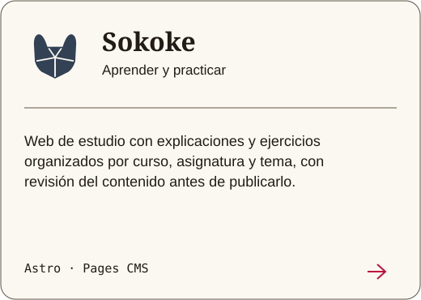
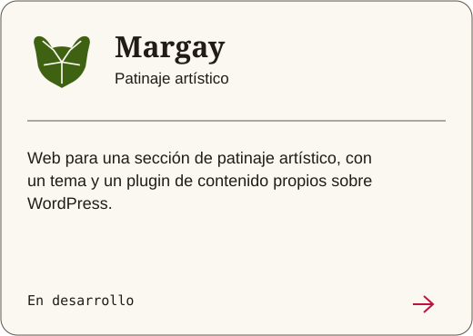

# XPayà · Xavier Payà

Construyo herramientas para explorar ideas: de una imagen a un contorno, de una descripción a una pieza y del material de estudio a una web donde practicar.

[Mi web](https://xpaya.dev) · [Sobre mí](https://xpaya.dev/sobre-mi/) · [Contacto](https://xpaya.dev/contacto/)

## Galería de felinos

Mis proyectos personales comparten una identidad, pero cada uno tiene su propio camino.

<a href="https://xpaya.dev/proyectos/serval/">
<picture>
  <source media="(prefers-color-scheme: dark)" srcset="assets/serval-dark.svg">
  
</picture>
</a>

Prototipo en Python que explora el paso de una descripción escrita a una geometría preparada para impresión 3D. No toda descripción produce una geometría válida.

[Conocer Serval →](https://xpaya.dev/proyectos/serval/)

<a href="https://xpaya.dev/proyectos/caracal/">
<picture>
  <source media="(prefers-color-scheme: dark)" srcset="assets/caracal-dark.svg">
  
</picture>
</a>

Contornia, la aplicación de escritorio de Caracal, convierte imágenes en contornos SVG que se pueden revisar y editar antes de exportarlos.

[Conocer Caracal →](https://xpaya.dev/proyectos/caracal/)

<a href="https://xpaya.dev/proyectos/jaguarundi/">
<picture>
  <source media="(prefers-color-scheme: dark)" srcset="assets/jaguarundi-dark.svg">
  
</picture>
</a>

Mi web personal y una prueba de concepto de coordinación de varios modelos de IA, con reglas explícitas y decisiones bajo supervisión humana.

[Conocer Jaguarundi →](https://xpaya.dev/proyectos/jaguarundi/)

<a href="https://xpaya.dev/proyectos/sokoke/">
<picture>
  <source media="(prefers-color-scheme: dark)" srcset="assets/sokoke-dark.svg">
  
</picture>
</a>

Web de estudio con explicaciones y ejercicios organizados por curso, asignatura y tema, con revisión del contenido antes de publicarlo.

[Conocer Sokoke →](https://xpaya.dev/proyectos/sokoke/)

<a href="https://xpaya.dev/proyectos/margay/">
<picture>
  <source media="(prefers-color-scheme: dark)" srcset="assets/margay-dark.svg">
  
</picture>
</a>

Web para una sección de patinaje artístico, con un tema y un plugin de contenido propios sobre WordPress.

**En desarrollo.**

[Conocer Margay →](https://xpaya.dev/proyectos/margay/)

<a href="https://xpaya.dev/proyectos/irbis/">
<picture>
  <source media="(prefers-color-scheme: dark)" srcset="assets/irbis-dark.svg">
  
</picture>
</a>

Proyecto de patronaje y diseño de maillots de patinaje artístico. Actualmente en fase de contratos de datos y pruebas de viabilidad.

**En desarrollo.**

[Conocer Irbis →](https://xpaya.dev/proyectos/irbis/)

---

### Herramientas con las que trabajo en estos proyectos

Python · .NET / WinUI · OpenCV · Astro · TypeScript · WordPress / PHP · SVG

Cada ficha explica el alcance del proyecto y sus límites. No todo el código es público.

[Explora XPayà →](https://xpaya.dev)
