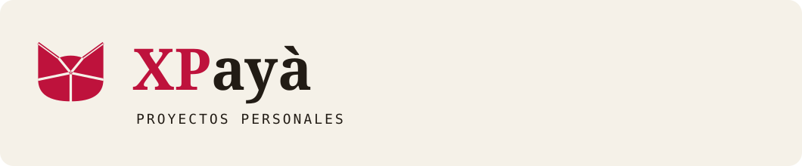
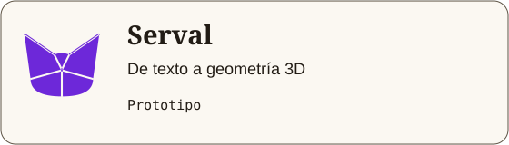
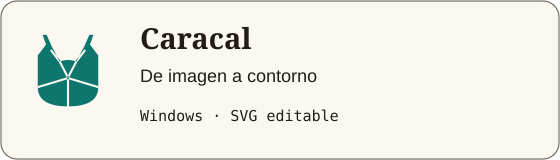
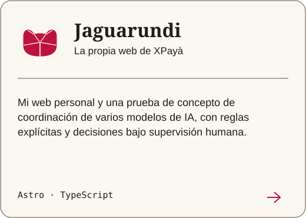

<a href="https://xpaya.dev">
<picture>
  <source media="(prefers-color-scheme: dark)" srcset="assets/cabecera-dark.svg">
  
</picture>
</a>

Construyo herramientas para explorar ideas: de una imagen a un contorno, de una descripción a una pieza y del material de estudio a una web donde practicar.

[Mi web](https://xpaya.dev) · [Sobre mí](https://xpaya.dev/sobre-mi/) · [Contacto](https://xpaya.dev/contacto/)

## Galería de felinos

Mis proyectos personales comparten una identidad, pero cada uno tiene su propio camino.

<table>
<tr>
<td width="50%" valign="top"><a href="https://xpaya.dev/proyectos/serval/">
<picture>
  <source media="(prefers-color-scheme: dark)" srcset="assets/serval-dark.svg">
  
</picture>
</a></td>
<td width="50%" valign="top"><a href="https://xpaya.dev/proyectos/caracal/">
<picture>
  <source media="(prefers-color-scheme: dark)" srcset="assets/caracal-dark.svg">
  
</picture>
</a></td>
</tr>
<tr>
<td width="50%" valign="top"><a href="https://xpaya.dev/proyectos/jaguarundi/">
<picture>
  <source media="(prefers-color-scheme: dark)" srcset="assets/jaguarundi-dark.svg">
  
</picture>
</a></td>
<td width="50%" valign="top"><a href="https://xpaya.dev/proyectos/sokoke/">
<picture>
  <source media="(prefers-color-scheme: dark)" srcset="assets/sokoke-dark.svg">
  
</picture>
</a></td>
</tr>
<tr>
<td width="50%" valign="top"><a href="https://xpaya.dev/proyectos/margay/">
<picture>
  <source media="(prefers-color-scheme: dark)" srcset="assets/margay-dark.svg">
  
</picture>
</a></td>
<td width="50%" valign="top"><a href="https://xpaya.dev/proyectos/irbis/">
<picture>
  <source media="(prefers-color-scheme: dark)" srcset="assets/irbis-dark.svg">
  
</picture>
</a></td>
</tr>
</table>

---

### Herramientas con las que trabajo en estos proyectos

Python · .NET / WinUI · OpenCV · Astro · TypeScript · WordPress / PHP · SVG

Cada ficha explica el alcance del proyecto y sus límites. No todo el código es público.

[Explora XPayà →](https://xpaya.dev)
